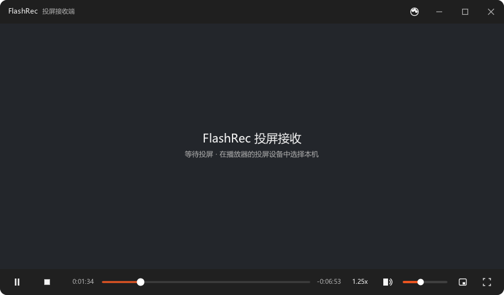

# FlashRec

[简体中文](README.md) | English

[](https://github.com/jianglinbin/FlashRec/actions/workflows/release.yml)

A LAN cast-receiver — DLNA / UPnP (DMR) and AirPlay in one app: cast video or your
entire screen from a phone to the PC and play it there.

C++20 with a fully self-drawn UI (nanovg / GLFW); Windows and Linux are both
first-class citizens.

## UI Preview

Playback UI (frameless + translucent top/bottom bars that auto-hide when idle +
thumbnail preview on timeline hover), default skin "Ubuntu Orange" (GNOME grey +
Ubuntu orange):



The 7 built-in skins only swap color and corner-radius tokens — the layout is
identical. Drop a custom skin JSON into the user skin directory `skins/` and hit
"Reload skins" in the tray menu to hot-load it.

## Download

Grab the installer for your platform from
[Releases](https://github.com/jianglinbin/FlashRec/releases) (every release ships
all four artifacts + `SHA256SUMS.txt`):

| Platform | File | Notes |
|---|---|---|
| Windows | `FlashRec-<ver>-win64.zip` | Portable, unzip and run |
| Windows | `FlashRec-<ver>-win64-setup.exe` | Installer (Inno Setup, no admin needed) |
| Debian / Ubuntu | `flashrec_<ver>_amd64.deb` | deb package |
| Linux generic | `FlashRec-<ver>-x86_64.AppImage` | Fully bundled, run directly |

## Features

- **AirPlay mirroring** (new in v0.6.0): open the system "Screen Mirroring" switch
  on iPhone / iPad / Mac and cast instantly — no extra app required. Built on a
  from-scratch adaptation of the UxPlay protocol stack.
- **AV sync**: audio-master clocking, measured `a−v = 0.000s` on real devices;
  playback start latency cut from 7.577s to **0.100s**, with steady-state receive
  backlog flat at 0.57–0.60s.
- **Dual protocols side by side**: AirPlay and DLNA listen concurrently; any new
  cast automatically takes over (last caster wins).
- **Standard DLNA DMR**: full AVTransport / RenderingControl / ConnectionManager
  services — discoverable and castable from any DLNA-capable app (system cast,
  bilibili, Tencent Video, etc.).
- **Correct on multi-NIC machines**: "reply on the interface that was asked" —
  M-SEARCH / SOAP / GENA answered on the peer's subnet, ALIVE / BYEBYE sent on
  every NIC, URLBase derived from the request Host header. No more "cast
  succeeded but can't connect" on multi-homed machines.
- **Self-drawn UI**: no native widgets, identical look across platforms and DPI;
  lives in the tray — closing the window minimizes to tray (device stays online),
  real exit via the tray menu.
- **Skin system**: the whole UI is token-driven JSON (`assets/skins.json`); 7
  built-in skins selected via `ui.skin` in `settings.json`; custom JSON in the
  user skin directory + tray "Reload skins" hot-loads it without a restart.
- **Smart video fit**: adaptive cover/contain per window/stage aspect — portrait
  mirroring fills the stage without stray black bars; DLNA direct-link movies
  still follow the skin's fit mode and never get cropped by surprise.
- **Playback**: libmpv backend, hardware decoding first; falls back to software
  rendering when the GL chain is unusable (old GPUs/drivers), and survives GPU
  driver faults (SEH guard) by degrading and resuming playback.
- **Cast presentation**: multi-monitor picker, per-monitor placement memory,
  auto-fullscreen on cast.
- **Speed control**: 0.5x–3.0x in 7 presets from the control bar (popup list),
  remembering your last pick; live-stream catch-up consumes buffer at automatic
  faster speed (scaletempo2, pitch preserved).

## Building

Prerequisites: CMake ≥ 3.24, Ninja, a C++20 compiler (MSVC 2022 or GCC 12+).

```bash
# 1. Fetch third-party sources (pupnp / libmpv / nanovg / GLFW / spdlog / uxplay)
bash tools/fetch_deps.sh

# 2. Configure and build
cmake --preset win-msvc && cmake --build build     # Windows (MSVC + Ninja)
cmake --preset linux-gcc && cmake --build build    # Linux (GCC/Clang + Ninja)
```

Platform notes:

- **Windows**: pupnp needs pthreads4w, which `fetch_deps.sh` does **not** fetch —
  build and install it into `third_party/pthreads4w/install` yourself (both the
  configure step and the packaging scripts look there). MSVC toolchain paths are
  centralized in `tools/msvc_env.sh` (`source` it to get absolute cmake / ninja /
  cl paths; adjust once for your VS install location).
- **Linux**: needs `cmake ninja-build`; `patchelf` additionally for AppImage;
  `libssl-dev libplist-dev` (system packages) to enable AirPlay.
- **AirPlay (v0.6.0)**: `fetch_deps.sh` clones UxPlay automatically (pinned at
  `57ea834`) and prepares openssl / libplist via vcpkg on Windows (incl.
  OPENSSL_Applink). Build switch `-DFR_AIRPLAY=ON/OFF`; dev default is OFF
  (artifact without GPL components), release builds pin ON
  (`tools/package_windows.sh` hard-codes it).

The default build is a windowless-console GUI binary (Windows GUI subsystem); use
`flashrec --console` to see logs, or configure `-DFLASHREC_CONSOLE=ON` for a
console build. Console output is UTF-8 — no mojibake for CJK logs.

## Packaging

```bash
bash tools/package_windows.sh            # → dist/FlashRec-<ver>-win64.zip
                                         #   + FlashRec-<ver>-win64-setup.exe (Inno Setup)
bash tools/package_linux.sh              # → dist/flashrec_<ver>_amd64.deb
                                         #   + FlashRec-<ver>-x86_64.AppImage
```

Both scripts support `--only` (`zip|exe` / `deb|appimage`), `--skip-build`,
`--clean`, `--smoke`. The Linux one **must run on Linux** (dependency inference
and AppImage tooling are Linux-only).

Alternatively skip local packaging: push a `v*` tag and
[GitHub Actions](.github/workflows/release.yml) builds all four artifacts for
both platforms and attaches them to the Release (`workflow_dispatch` for
artifact-only manual runs).

## Usage

The app lives in the tray once started. With phone and PC on the same LAN:

- **DLNA cast**: cast to "FlashRec" from any DLNA-capable app.
- **AirPlay mirroring**: open "Screen Mirroring" on iPhone / iPad / Mac and pick
  "FlashRec" for full-screen live mirroring; PIN verification mode supported
  (`airplay.pin_auth`).

Closing the window minimizes to tray (device stays online); exit via the tray
menu. AirPlay and DLNA run concurrently — any new cast takes over the session.

Skins: set `ui.skin` in `settings.json` to a built-in skin id (`nord-snow` /
`nord-frost` / `nord-rose` / `nord-iris` / `nord-night` / `nord-forest` /
`ubuntu-orange`), or drop your own JSON into the user skin directory and hit
tray "Reload skins".

UI language: follows the system UI language by default (`ui.language` in
`settings.json`, `auto` / `zh-CN` / `en-US`); switch instantly via the
"Language" submenu in the context menu or the two language entries at the bottom
of the tray menu — no restart needed.

## Repository Layout

| Directory | Role |
|---|---|
| `src/app/` | Event bus, config, logging, lifecycle |
| `src/dmr/` | UPnP device & services, SOAP dispatch, GENA |
| `src/cast/` | AirPlay adapter (UxPlay lib wiring, TS loopback, session lifecycle) |
| `src/player/` | mpv wrapper (the only mpv API boundary), playback state machine |
| `src/ui/` | nanovg drawing, theme, views & widgets |
| `src/platform/` | Window, tray, keep-awake, paths, NIC enumeration |
| `cmake/` | Build modules (dependency list, platform switches, 3rd-party patch anchors, packaging) |
| `assets/` | Bundled resources: fonts, icons, SCPD XML, default config, skins |
| `design/` | Skin design source of truth (`skins.json` + preview page) |
| `docs/` | README images (UI preview) |
| `tools/` | Build / package / self-check scripts |
| `tests/` | Protocol acceptance & self-check scripts |

Hard architectural constraints (important when changing things): `ui` / `dmr` /
`player` never call each other directly — they communicate only via the event
bus; `cast/` likewise posts commands through the event bus and feeds mpv over a
local loopback TCP data path; platform macros are allowed only in
`src/platform/`; the playback state machine's single source of truth is
`src/player/player_controller`; visual tokens live only in the `Theme` struct —
zero literal colors in drawing code.

## Notes

This repository contains source code and build assets only. Development logs
(version ledger, planning documents) are not published here.

## License

This project is licensed under **GNU GPLv3**, see [LICENSE](LICENSE).

- The AirPlay receiver bundled since v0.6.0 statically links
  [UxPlay](https://github.com/FDH2/UxPlay) (GPLv3); official release packages
  (`FR_AIRPLAY=ON`) are therefore distributed under GPLv3, and the source is
  licensed GPLv3 as well to keep source and binaries consistent.
- Third-party components' licenses and provenance are documented in
  [THIRD_PARTY_NOTICES.md](THIRD_PARTY_NOTICES.md): libmpv is LGPLv2.1+ / GPLv2+
  (dynamically linked), nanovg / GLFW (zlib), pupnp (BSD-3), spdlog (MIT), etc.
  distributed with their upstreams.
